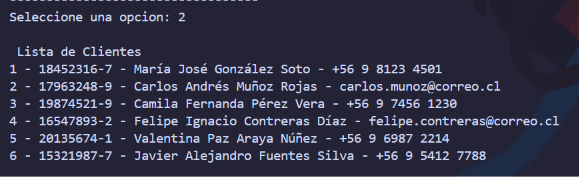
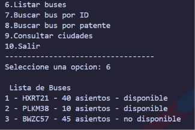
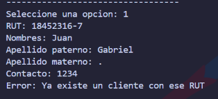
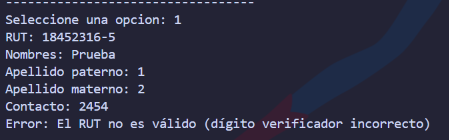
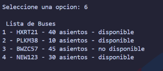

# Trabajo-Estructura-Grupo
## Parte A: archivos, ciudades, clientes y buses

### Modulos
- archivos.py: funciones para leer y guardar los archivos JSON (leer_archivo, guardar_archivo, siguiente_id). Si el archivo no existe o esta vacio, devuelve una lista vacia y el programa no se cae.
- ciudades.py: catalogo fijo de las 6 ciudades del recorrido con su posicion (0 = Concepcion, 5 = Santiago). Se crea solo la primera vez.
- clientes.py: registrar y buscar clientes. Valida campos obligatorios, el digito verificador del RUT y que no se repita el RUT.
- buses.py: registrar y buscar buses. Valida patente unica, capacidad positiva y estado (disponible / no disponible).

### Archivos de datos
| Archivo | Campos |
|---|---|
| clientes.json | id_cliente, rut, nombres, apellido_paterno, apellido_materno, contacto |
| buses.json | id_bus, patente, capacidad, estado |
| ciudades.json | id_ciudad, nombre, posicion |

Los archivos se relacionan por ID: los viajes usan id_bus y los pasajes usan id_cliente. No hay duplicacion de datos entre archivos.

### Validaciones y errores
Las funciones no imprimen: lanzan ValueError cuando un dato no es valido y el menu muestra el mensaje con try/except. La conversion de numeros (int) se controla aparte.

### Como probar (menu_actualizado.py)
1. Listar clientes, buses y ciudades: deben cargarse al reiniciar.
2. Registrar un cliente con RUT repetido: se rechaza.
3. Registrar un RUT con digito verificador incorrecto: se rechaza.
4. Registrar un bus con patente repetida: se rechaza.
5. Registrar un bus con capacidad 0, negativa o texto: se rechaza.

## Datos Cargados Clientes

## Buses Cargados

## Ciudades

## Cliente Duplicado 

## Rut Invalido

## Patente Duplicada 

## Capacidad Invalida 

## Registro Valido

## Reinicio

 El Bus nuevo sigue en la lista 
