# Trabajo-Estructura-Grupo (Valentina Vivanco, Antonio Constanzo, Franco Valenzuela)
## NOTA: Para ejecutar programa, ejecutar menu.py con "python menu.py"
## Parte A: archivos, ciudades, clientes y buses

### Modulos
- archivos.py: funciones para leer y guardar los archivos JSON (leer_archivo, guardar_archivo, siguiente_id). Si el archivo no existe o esta vacio, devuelve una lista vacia y el programa no se cae.
- ciudades.py: catalogo fijo de las 6 ciudades del recorrido con su posicion (0 = Concepcion, 5 = Santiago). Se crea solo la primera vez.
- clientes.py: registrar y buscar clientes. Valida campos obligatorios, el digito verificador del RUT y que no se repita el RUT.
- buses.py: registrar y buscar buses. Valida patente unica, capacidad positiva y estado (disponible / no disponible).

### Archivos de datos
| Archivo | Campos |
|---|---|
| clientes.json | id_cliente, rut, nombres, apellido_paterno, apellido_materno, contacto |
| buses.json | id_bus, patente, capacidad, estado |
| ciudades.json | id_ciudad, nombre, posicion |

Los archivos se relacionan por ID: los viajes usan id_bus y los pasajes usan id_cliente. No hay duplicacion de datos entre archivos.

### Validaciones y errores
Las funciones no imprimen: lanzan ValueError cuando un dato no es valido y el menu muestra el mensaje con try/except. La conversion de numeros (int) se controla aparte.

### Como probar (menu_actualizado.py)
1. Listar clientes, buses y ciudades: deben cargarse al reiniciar.
2. Registrar un cliente con RUT repetido: se rechaza.
3. Registrar un RUT con digito verificador incorrecto: se rechaza.
4. Registrar un bus con patente repetida: se rechaza.
5. Registrar un bus con capacidad 0, negativa o texto: se rechaza.

## Datos Cargados Clientes


## Buses Cargados


## Ciudades
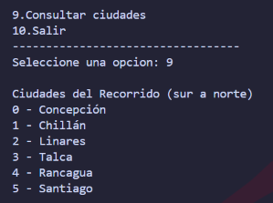

## Cliente Duplicado 


## Rut Invalido


## Patente Duplicada 
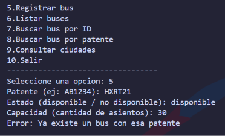

## Capacidad Invalida 
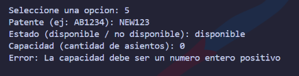

## Registro Valido
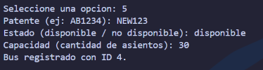

## Reinicio
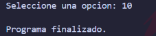
 El Bus nuevo sigue en la lista 

## Parte B: viajes, tarifas, asientos y pasajes

### Modulos
- tarifas.py: calcula el precio de un pasaje segun los segmentos que recorre (calcular_tarifa). Descuenta 10% de la tarifa base por cada uno de los 5 segmentos que no se usan, sin tabla de combinaciones.
- asientos.py: representa cada pasaje como un tramo y revisa si dos tramos se superponen (tramos_se_superponen, asiento_libre_en_tramo). Tambien entrega los asientos ocupados y libres de un tramo.
- viajes.py: programar y buscar viajes. Valida bus existente y disponible, fecha, hora, que el viaje sea Concepcion-Santiago o Santiago-Concepcion y que un bus no tenga dos viajes a la misma fecha y hora.
- pasajes.py: venta, anulacion, listado de pasajes de un viaje (vigentes y anulados) y recaudacion vigente.
- consola.py: mensajes con colores (colorama) para titulos, confirmaciones, errores y advertencias.
- integracion_menu.py: funciones que conectan estos modulos con las opciones del menu.

### Archivos de datos
| Archivo | Campos |
|---|---|
| viajes.json | id_viaje, id_bus, fecha, hora, id_origen, id_destino, tarifa_base |
| pasajes.json | id_pasaje, id_viaje, id_cliente, id_origen, id_destino, asiento, valor, estado |

Los viajes usan id_bus, id_origen e id_destino (IDs de ciudades), y los pasajes usan id_viaje e id_cliente. No hay duplicacion de datos entre archivos.

### Reglas de negocio
- Tarifa: con base $10.000, Concepcion-Santiago cuesta $10.000, Chillan-Santiago $9.000, Concepcion-Talca $8.000, Chillan-Talca $7.000 y Santiago-Rancagua o Talca-Linares $6.000. No depende del sentido.
- Venta: el cliente y el viaje deben existir, el origen debe ser distinto del destino, el tramo debe respetar el sentido del viaje y el asiento debe estar dentro de la capacidad del bus.
- Reutilizacion de asientos: un asiento se puede vender varias veces en un viaje si los tramos no se superponen. El descenso en una ciudad libera el asiento para un embarque en esa misma ciudad.
- Anulacion: el pasaje no se borra, cambia su estado de vigente a anulado. Libera el asiento solo en su tramo, no se puede anular dos veces y no cuenta en la ocupacion ni en la recaudacion.

### Estructuras y algoritmos
- Busqueda secuencial: buscar_viaje, buscar_pasaje y asiento_libre_en_tramo recorren las listas cargadas desde los JSON. Las listas son pequenas y no necesitan estar ordenadas. asiento_libre_en_tramo debe revisar todos los pasajes vigentes del viaje para comparar tramos, por eso no aplica una busqueda binaria. Sirve para validar que un viaje exista, anular un pasaje por su ID y decidir si un asiento esta libre en un tramo.
- Superposicion de tramos (decision de diseno de asientos.py): cada pasaje es un intervalo (inicio, fin) con las posiciones de las ciudades, y dos tramos se superponen cuando inicio_a < fin_b y inicio_b < fin_a. Chillan-Talca (1, 3) y Linares-Rancagua (2, 4) se superponen y se rechazan. Concepcion-Chillan (0, 1) y Chillan-Talca (1, 3) no se superponen y el asiento se reutiliza. Como el tramo se ordena con min y max, funciona igual en ambos sentidos del viaje.

### Validaciones y errores
Igual que en la Parte A, las funciones no imprimen: lanzan ValueError cuando un dato no es valido y el menu muestra el mensaje con try/except. La conversion de numeros (int) se controla aparte.

### Como probar (desde el menu)
1. Programar un viaje Concepcion-Santiago con un bus disponible: se registra.
2. Programar un viaje con un bus inexistente o no disponible: se rechaza.
3. Programar un viaje Concepcion-Talca: se rechaza.
4. Programar dos viajes con el mismo bus, fecha y hora: el segundo se rechaza.
5. Vender Concepcion-Santiago, Chillan-Santiago y Santiago-Rancagua en un viaje con base $10.000: el valor queda en $10.000, $9.000 y $6.000.
6. Vender con origen igual al destino: se rechaza.
7. Vender un asiento sobre la capacidad del bus: se rechaza.
8. Vender un tramo contrario al sentido del viaje: se rechaza.
9. Vender el asiento 12 de Concepcion-Chillan, luego Chillan-Talca y luego Talca-Santiago: se permite.
10. Vender el asiento 12 de Chillan-Talca y luego Linares-Rancagua: el segundo se rechaza.
11. Anular un pasaje vigente: queda anulado y su asiento solo se libera en ese tramo.
12. Anular el mismo pasaje otra vez: se rechaza.
13. Consultar la recaudacion del viaje despues de anular: no incluye el pasaje anulado.
14. Reiniciar la aplicacion: los viajes, los pasajes y sus estados se conservan.

## Viaje Programado
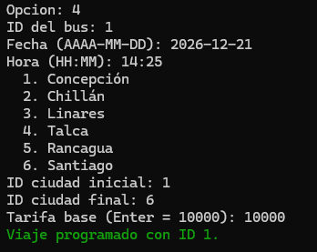

## Viaje Rechazado
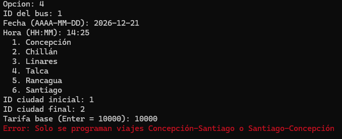

## Tarifas
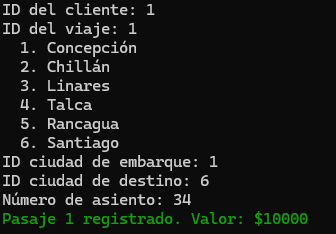
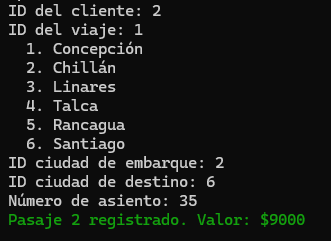

## Asiento Reutilizado
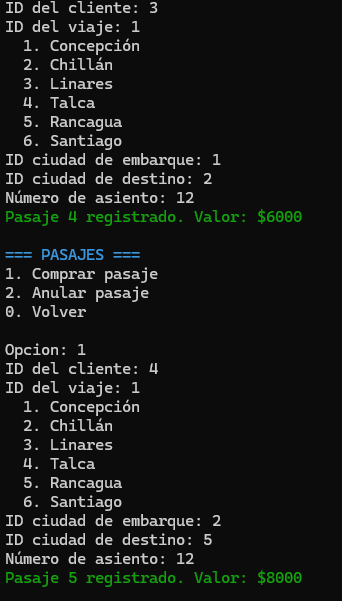

## Asiento Superpuesto
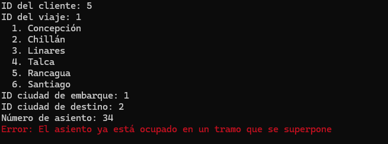

## Capacidad e Invalidos
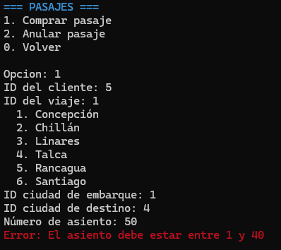
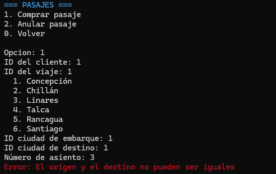

## Pasajes del Viaje
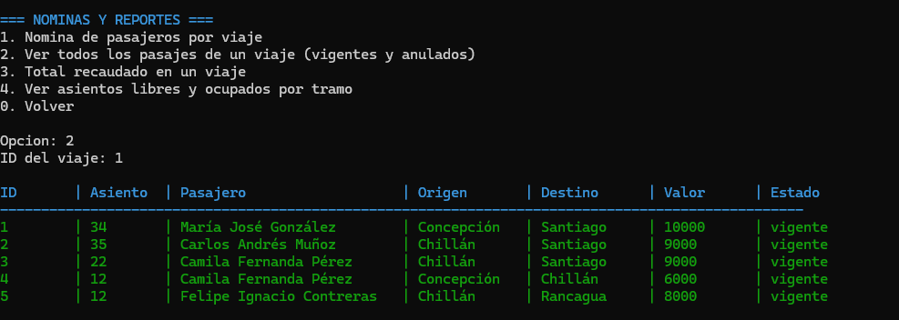

## Anulación
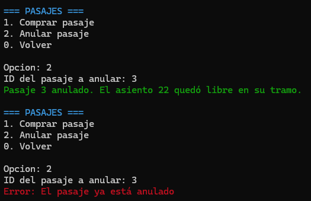


## Parte C: nominas, reportes y menu principal

### Modulos
- reportes.py: genera la nomina de pasajeros de un viaje cruzando los pasajes vigentes con clientes y ciudades, implementa el ordenamiento propio mediante Bubble Sort y calcula los reportes de pasajes del viaje, recaudacion vigente y ocupacion de asientos por tramo.
- main.py (o menu_actualizado.py): punto de entrada de la aplicacion de consola. Contiene el bucle principal, los submenus de cada modulo, el manejo de excepciones y la interfaz visual con Colorama (cian para titulos, verde para confirmaciones, rojo para errores y amarillo para advertencias).
- requirements.txt: archivo de dependencias del proyecto con la libreria colorama.

### Reglas de negocio
- Nomina de pasajeros: muestra unicamente los pasajes con estado vigente de un viaje seleccionado, indicando asiento, apellido paterno, apellido materno, nombres, ciudad de embarque y destino final.
- Criterios de ordenamiento: permite ordenar la nomina de forma ascendente por (a) apellido paterno (desempate por apellido materno y nombres), (b) nombres (desempate por apellido paterno y materno) o (c) numero de asiento (desempate por posicion de la ciudad de embarque).
- Inmutabilidad en disco: el ordenamiento de la nomina se realiza sobre una copia en memoria para su visualizacion, sin modificar el orden original guardado en pasajes.json.
- Reportes de gestion: permite listar el historial completo de pasajes de un viaje diferenciando vigentes y anulados, calcular la recaudacion total excluyendo anulados y revisar que asientos estan ocupados o libres en un tramo especifico.

### Estructuras y algoritmos
- Ordenamiento propio (Bubble Sort en reportes.py): para cumplir con la restriccion de no utilizar sort() ni sorted() en la nomina, se implemento el algoritmo Bubble Sort optimizado con corte temprano (bandera de intercambio) sobre una copia de la lista de pasajeros del viaje. Como la capacidad maxima de un bus interurbano es acotada (entre 40 y 60 pasajeros), su complejidad $O(N^2)$ en el peor caso y $O(N)$ cuando ya esta ordenado resulta adecuada, ademas de ser un algoritmo estable que respeta los criterios de desempate sin alterar el archivo persistido.
- Indexacion en memoria con diccionarios: antes de cruzar los pasajes con clientes y ciudades para armar la nomina y los reportes, se construyen diccionarios indexados por id_cliente e id_ciudad. Esto permite resolver cada cruce en tiempo promedio $O(1)$ en lugar de recorrer las listas completas por cada pasaje.

## Menu Principal
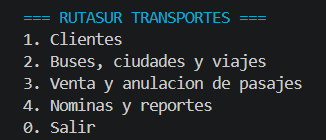

## Nomina Ordenada
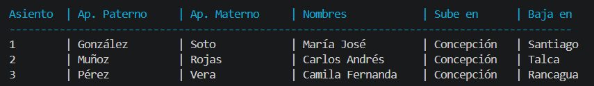

## Historial de Pasajes (Vigentes y Anulados)
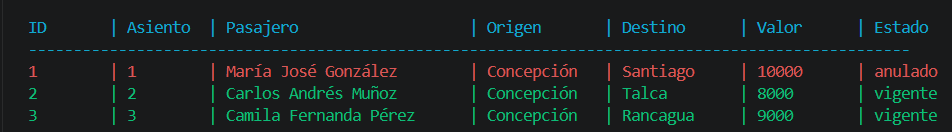

## Uso de Colorama (Titulos y Mensajes)
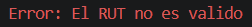
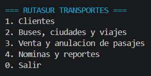
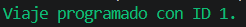


## dejenos pasar profe porfavor

### Instalacion y ejecucion
1. Instalar dependencias:
   ```bash
   pip install -r requirements.txt


   ## dejenos pasar profe porfavor
